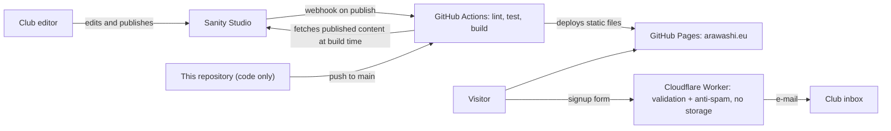

# Arawashi – karate club website

Website of **Arawashi**, a WKF karate club in the Siechnice municipality near Wrocław, Poland.
The site is in Polish; the code and documentation are in English.

> **Status:** feature-complete and tested; waiting for the club's content and the production
> setup (GitHub Pages, DNS, CMS project, Worker secrets). See [`docs/setup.md`](docs/setup.md).

## Highlights

- **Static and fast**: Astro renders every page to HTML at build time. Content pages ship only a
  tiny inline script that improves the mobile menu (it also works without it); React is loaded
  only for the signup form and the schedule filter. Motion is CSS-only and respects
  `prefers-reduced-motion`.
- **Editable by the club**: content is managed in a headless CMS (Sanity Studio in Polish) and
  the site rebuilds automatically when an editor publishes a change.
- **Resilient content layer**: CMS data is validated with Zod at build time; invalid documents
  are skipped, and sections without content show a "coming soon" state instead of failing.
- **Privacy by design**: the repository contains code only. Club content, photos and contact
  details live in the CMS, signup data goes straight to the club and is never stored, and the
  site sets no cookies and loads no third-party embeds.
- **Content Security Policy**: a strict CSP `<meta>` tag with hashed scripts (GitHub Pages
  cannot send headers); an E2E test fails on any CSP violation.
- **Polish typesetting**: non-breaking spaces keep one-letter words, abbreviations and postal
  codes with the next word, applied at build time to CMS text too; a CI check of the built HTML
  rejects regressions.
- **Quality gates in CI**: ESLint, Prettier, `astro check` (strictest TypeScript), Vitest,
  and Playwright end-to-end tests with automated axe accessibility scans (WCAG 2.2 A/AA).

## Tech stack

| Area        | Choice                                                                      |
| ----------- | --------------------------------------------------------------------------- |
| Framework   | [Astro 7](https://astro.build) (static output) + React 19 islands           |
| Language    | TypeScript 6 (`astro/tsconfigs/strictest`)                                  |
| Styling     | Tailwind CSS 4 with brand design tokens                                     |
| Content     | Sanity headless CMS (GROQ, Portable Text), Studio with Polish UI            |
| Signup form | Cloudflare Worker + Turnstile + Brevo e-mail API, shared Zod schema         |
| Hosting     | GitHub Pages, deployed with GitHub Actions                                  |
| Tooling     | pnpm workspaces, ESLint, Prettier, Vitest, Playwright, axe-core, Dependabot |

## Architecture



## Repository structure

```text
apps/web/                 Astro site
  src/pages/              routes (Polish URLs)
  src/components/         header, footer, signup form and schedule filter (React islands)
  src/lib/content/        CMS loader: GROQ query, mapping, Zod schema, test fixtures
  e2e/                    Playwright end-to-end and accessibility tests
apps/studio/              Sanity Studio (content schemas, Polish UI)
apps/signup-worker/       Cloudflare Worker that e-mails signups to the club
packages/signup-schema/   validation shared by the form and the Worker
docs/                     setup guide and architecture decision records
scripts/                  repository tooling (CI hygiene and typography checks)
```

## Getting started

Requirements: Node.js 24 or newer (see `.nvmrc`) and pnpm 12.

```sh
pnpm install
pnpm dev          # http://localhost:4321
```

## Scripts

| Command            | What it does                                                    |
| ------------------ | --------------------------------------------------------------- |
| `pnpm dev`         | Start the development server                                    |
| `pnpm build`       | Build the static site into `apps/web/dist`                      |
| `pnpm preview`     | Serve the production build locally                              |
| `pnpm check`       | Type-check every package (`astro check`, `tsc`)                 |
| `pnpm lint`        | Run ESLint                                                      |
| `pnpm format`      | Format all files with Prettier                                  |
| `pnpm test`        | Run unit tests in every package (Vitest)                        |
| `pnpm test:e2e`    | Run end-to-end and accessibility tests (Playwright + axe)       |
| `pnpm studio:dev`  | Run the Sanity Studio locally                                   |
| `pnpm check:paths` | Fail if files outside the allow-listed paths would be committed |
| `pnpm check:html`  | Check Polish typography in the built HTML (after `pnpm build`)  |

Without a CMS configured, the site builds with "coming soon" sections. Set
`CONTENT_SOURCE=fixtures` to preview it with synthetic content. The E2E tests build the site with
fixtures automatically; on a fresh machine install the browser once with
`pnpm --filter @arawashi/web exec playwright install chromium`.

Deployment and service setup: [`docs/setup.md`](docs/setup.md). Design decisions:
[`docs/decisions/`](docs/decisions/).

## Privacy

This repository is public, so it holds code only. Club content (news, schedule, photos, contact
details) is managed in the CMS and fetched at build time, and the built site is deployed as an
artifact, never committed. Signup data is sent from the browser to a stateless function that
e-mails it to the club; nothing is stored. A CI check rejects images or documents outside the
approved asset folders.

## License

The source code is available under the [MIT License](LICENSE).

The MIT License does **not** cover the club name and logo, the logos of Gmina Siechnice,
Polska Unia Karate and the World Karate Federation, or any club texts and photos. They remain
the property of their respective owners and are used on the website with permission.

The default home page photo (`apps/web/src/assets/hero/karate-belt.jpg`) is by Nguyen Hung,
from [Unsplash](https://unsplash.com/photos/FktPF6cwIWo), used under the
[Unsplash License](https://unsplash.com/license). It is not covered by the MIT License either.
